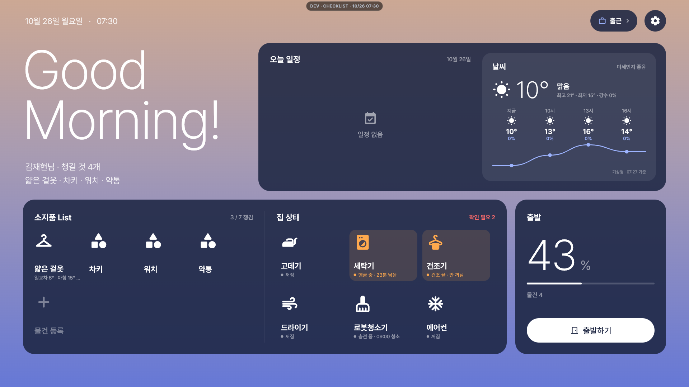
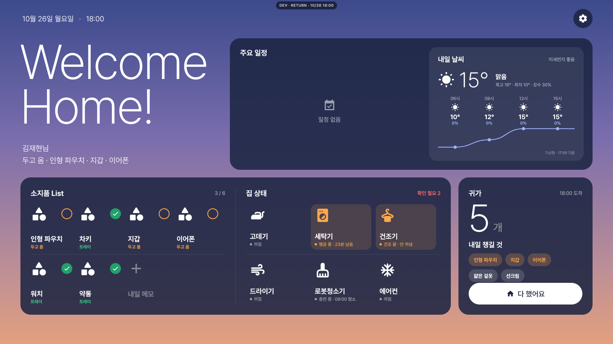
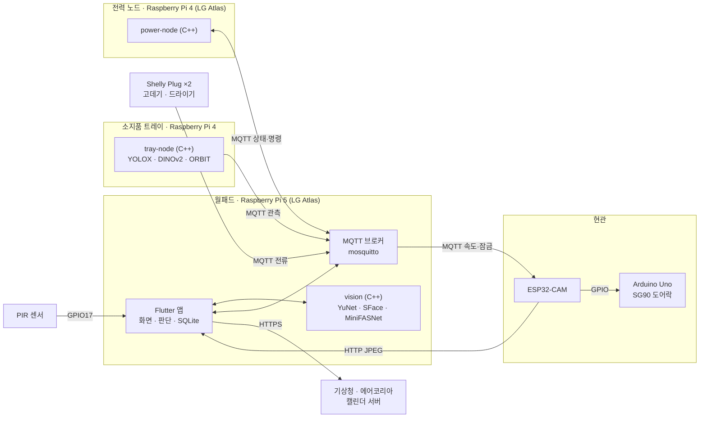
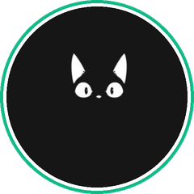

# 제24회 임베디드 소프트웨어 경진대회 스마트가전 부문 LEAVEGUARD

### 작품명 : LeaveGuard — 외출·귀가를 지켜 주는 AI 월패드

<div align="center">


</div>

현관 월패드가 얼굴로 가족을 알아보고, 소지품 트레이 카메라와 가전 전류를 함께 보면서 **나가기 전에 빠뜨린 물건과 켜 둔 가전**을 먼저 알려 준다.
귀가하면 현관 카메라가 얼굴을 확인해 문을 열고, 오늘 가져간 물건을 다시 가져왔는지 묻고, 두고 온 것은 다음 날 아침 외출 화면에 다시 띄운다.

<br>

## 목차

1. [주요 기능](#주요-기능)
2. [시스템 구성](#시스템-구성)
3. [하드웨어](#하드웨어)
4. [소프트웨어](#소프트웨어)
5. [AI 모델](#ai-모델)
6. [파일 구성](#파일-구성)
7. [빌드 및 실행](#빌드-및-실행)
8. [라이선스](#라이선스)
9. [Collaborator](#collaborator)

<br>

## 주요 기능

#### 얼굴 인식 로그인
- 월패드 카메라로 가족을 알아보고(YuNet + SFace) 그 사람의 외출 화면을 띄운다. 실패하면 사용자 선택 후 PIN 으로 본인 확인
- 첫 실행 온보딩에서 얼굴 등록, PIN, 생활 패턴(출발·귀가 시각), 캘린더 연동, 소지품 등록까지 한 번에 진행
- 월패드 위 PIR 센서가 출근 시간대에 사람이 다가오면 화면을 먼저 깨운다

#### 소지품 트레이
- 현관 트레이 위 카메라(Raspberry Pi 4)가 물건 박스를 찾고(YOLOX) 특징 벡터(DINOv2 + ORBIT)를 뽑아 월패드로 보낸다
- 월패드가 등록된 물건과 비교해 **있음 · 챙김 · 어제부터 없음 · 이미 챙겼어요 · 미확인** 다섯 상태로 보여 준다
- 확신이 낮으면 "혹시 ○○인가요?" 하고 물어보고, 답을 받으면 그 각도를 새로 학습한다. 아니라고 하면 다른 물건(예: 다른 물건의 뒷면)으로 고를 수 있다
- 등록할 때 돌려 놓인 모습(90 · 180 · 270°)도 함께 저장하고, 같은 이름을 다시 등록하면 그 물건의 다른 면인지 묻는다
- 물건이 안 보이는데 그 자리에 못 알아보는 박스가 있으면(뒤집힘 · 옆으로 세움 · 손에 가림) 바로 "챙김"으로 바꾸지 않고 물어본다
- 움직임이 멈춘 직후에는 약 1초마다 다시 보고, 평소에는 2초 남짓마다 본다
- 시연 자리를 잡을 때는 트레이 노드 웹 페이지(`:8080`)에서 검은 판 네 모서리를 빨간 박스로 잡아 화면에 꽉 차게 편다
- 가족이 함께 쓰는 물건은 누가 언제 가져갔는지 기록한다

#### 오늘 챙길 것
- 기상청 날씨·에어코리아 미세먼지·자외선과 캘린더 일정으로 우산·마스크·선크림 같은 준비물을 골라 체크리스트로 만든다
- 함께 외출하는 가족을 묶어서 한 번에 확인할 수 있다

#### 가전 안전
- 전력 노드(Raspberry Pi 4, LG Atlas)가 Shelly 스마트 플러그 전류로 고데기·드라이기 사용 여부를 판단한다
- 켜진 채 나가려 하면 외출 화면에서 경고하고, 월패드에서 바로 끌 수 있다. 전력 노드가 없으면 플러그에 직접 명령한다

#### 현관 카메라와 도어락
- ESP32-CAM 이 평소 초당 3장을 보내다가 얼굴이 보이면 초당 12장으로 올린다
- 월패드가 얼굴 인식과 위조 검사(MiniFASNet)를 해서 가족이면 도어락(Arduino Uno + SG90)을 열고 귀가 화면으로 바로 로그인한다
- 모르는 사람이면 사진을 남기고 [무시] / [문 열기] 를 묻는다

#### 귀가 확인
- 오늘 가져간 물건을 다시 가져왔는지 확인하고, 두고 온 것은 내일 아침 외출 화면에 "어제 밖에 두고 왔어요" 로 띄운다
- 음성으로 내일 챙길 메모를 남길 수 있다 (최대 10초, whisper 받아쓰기 → LLM 으로 한 줄 정리)

<br>

## 시스템 구성



| 연결 | 방식 |
|---|---|
| 트레이 → 월패드 | MQTT `leaveguard/belongings/tray01/…` (관측·상태), HTTP `:8080` (미리보기) |
| 전력 노드 ↔ 월패드 | MQTT `leaveguard/power/<가전>/state · set`, `shelly/<가전>/sensor` |
| 현관 카메라 → 월패드 | HTTP `POST :8000/api/camera/frames`, MQTT `leaveguard/esp32cam/cam1/face` |
| 월패드 → 도어락 | MQTT `leaveguard/door/lock/set` → ESP32-CAM GPIO13 → Uno D2 → SG90(D9) |

<br>

## 하드웨어

| 장치 | 보드 | 역할 |
|---|---|---|
| 월패드 | Raspberry Pi 5 + 15.6인치 FHD 터치 디스플레이 + USB 카메라 + PIR | LG Atlas OS, 화면·얼굴 인식·판단·DB·MQTT 브로커 |
| 소지품 트레이 | Raspberry Pi 4 + Camera Module 3 | 트레이 촬영, 물건 탐지·특징 추출 |
| 전력 노드 | Raspberry Pi 4 + Shelly Plug ×2 | LG Atlas OS, 가전 사용 판단·전원 제어 |
| 현관 카메라 | ESP32-CAM | 얼굴 감지용 프레임 전송, 도어락 신호 |
| 도어락 | Arduino Uno R3 + SG90 서보 | 문 열기·잠그기 |

<br>

## 소프트웨어

| 구성 | 언어 · 프레임워크 | 위치 |
|---|---|---|
| 월패드 앱 | Flutter (flutter-elinux, LG Atlas), Dart, SQLite | [`wallpad/`](wallpad/README.md) |
| 얼굴 인식 · 카메라 | C++17, OpenCV DNN | [`wallpad/atlas/vision/`](wallpad/atlas/vision) |
| MQTT 브로커 | Eclipse Mosquitto 2.0.21 | [`wallpad/atlas/broker/`](wallpad/atlas/broker) |
| 트레이 노드 | C++17, OpenCV DNN, libcamera(rpicam), libmosquitto | [`tray-node/`](tray-node/README.md) |
| 전력 노드 | C++, libmosquitto, Shelly Script | [`power-node/`](power-node/README.md) |
| 현관 카메라 | ESP32-CAM (ESP32), C++ | [`door-node/esp32cam/`](door-node/esp32cam) |
| 도어락 | Arduino Uno, C++ | [`door-node/doorlock_uno/`](door-node/doorlock_uno) |
| 모델 변환 · 학습 | Python, PyTorch, ONNX | [`tools/`](tools/README.md) |

<br>

## AI 모델

| 용도 | 모델 | 실행 위치 | 라이선스 |
|---|---|---|---|
| 얼굴 검출 | YuNet (2023mar) | 월패드 | MIT |
| 얼굴 인식 | SFace (2021dec) | 월패드 | Apache-2.0 |
| 위조 검사 | MiniFASNet V2 2.7x + V1SE 4.0x | 월패드 | Apache-2.0 |
| 물건 탐지 | YOLOX-Nano, 트레이 데이터로 학습 (512) | 트레이 | Apache-2.0 |
| 물건 재식별 | DINOv2-S reg (168) + ORBIT ProtoNets EfficientNet-B0 | 트레이 | Apache-2.0 · MIT |
| 음성 받아쓰기 | Whisper small (whisper.cpp) | 월패드 | MIT |
| 메모 정리 | EXAONE 4.0 1.2B (llama.cpp) | 월패드 | EXAONE AI Model License (NC) |

- ONNX 모델은 [`models/`](models) 에 있고, 라이선스 전문은 [`models/LICENSES/`](models/LICENSES) 에 있다.
- Whisper·EXAONE 은 저장소에 포함하지 않는다. 보드에 둘 파일과 출처는 [`wallpad/README.md`](wallpad/README.md) 참고.
- 트레이 탐지기 학습 데이터와 스크립트는 [`tools/README.md`](tools/README.md) 참고.

<br>

## 파일 구성

```text
📦 2026ESWContest_smart_LEAVEGUARD
 ┣ 📂 wallpad            월패드 앱 (Raspberry Pi 5, LG Atlas)
 ┃ ┣ 📂 lib
 ┃ ┃ ┣ 📂 app            앱 상태 · 화면 전환
 ┃ ┃ ┣ 📂 core           설정 · SQLite · 디자인 토큰
 ┃ ┃ ┣ 📂 device         카메라 · MQTT · 전력 · 현관 카메라 · 음성 · PIR · Wi-Fi
 ┃ ┃ ┣ 📂 features       인증 · 온보딩 · 외출/귀가 · 소지품 · 현관 · 설정 · 날씨 · 캘린더
 ┃ ┃ ┗ 📂 shared         공통 위젯
 ┃ ┣ 📂 atlas
 ┃ ┃ ┣ 📂 vision         얼굴 인식 C++
 ┃ ┃ ┣ 📂 broker         mosquitto 빌드 · 설정
 ┃ ┃ ┗ 📂 runner         Flutter 실행기
 ┃ ┣ 📂 system           D-Bus 정책 (PIR GPIO)
 ┃ ┗ 📂 test
 ┣ 📂 tray-node          소지품 트레이 노드 (Raspberry Pi 4)
 ┃ ┣ 📂 src
 ┃ ┗ 📂 deploy           systemd 서비스 · 설정 예시
 ┣ 📂 power-node         전력 노드 (Raspberry Pi 4, LG Atlas)
 ┃ ┣ 📂 src
 ┃ ┣ 📂 shelly           Shelly Plug 스크립트
 ┃ ┗ 📂 docs             MQTT 토픽 · Atlas 에서 MQTT 쓰기
 ┣ 📂 door-node
 ┃ ┣ 📂 esp32cam         현관 카메라 펌웨어
 ┃ ┗ 📂 doorlock_uno     도어락 펌웨어
 ┣ 📂 models             ONNX 모델 · 라이선스
 ┣ 📂 tools              모델 변환 · 트레이 탐지기 학습
 ┗ 📂 docs/images
```

<br>

## 빌드 및 실행

```bash
git clone https://github.com/denny1105kim/2026ESWContest_smart_LEAVEGUARD.git
cd 2026ESWContest_smart_LEAVEGUARD
```

1. **월패드 (Raspberry Pi 5, LG Atlas)** — [wallpad/README.md](wallpad/README.md)
   - LG전자 제공 개발 환경에서 `wallpad/` 를 빌드해 IPK 로 설치한다. 개발 환경은 저장소에 포함하지 않는다.
2. **소지품 트레이 (Raspberry Pi 4, Raspberry Pi OS)** — [tray-node/README.md](tray-node/README.md)
   ```bash
   cd tray-node
   cmake -S . -B build -DCMAKE_BUILD_TYPE=Release
   cmake --build build -j4
   ```
   설치(실행 파일 · 설정 · 모델 · systemd 서비스)는 tray-node README 의 순서대로 한다.
3. **전력 노드 (Raspberry Pi 4, LG Atlas)** — [power-node/README.md](power-node/README.md)
   - LG전자 제공 개발 환경에서 `power-node/` 를 빌드해 설치한다.
4. **현관 카메라 (ESP32-CAM)** — [door-node/README.md](door-node/README.md)
   - `esp32cam/secrets.h.example` 을 `secrets.h` 로 복사해 Wi-Fi 정보를 넣고, ESP32 보드 패키지를 설치한 Arduino IDE 로 업로드
5. **도어락 (Arduino Uno)**
   - `doorlock_uno/doorlock_uno.ino` 를 Arduino Uno 에 업로드

<br>

## 라이선스

이 저장소의 코드는 [Apache License 2.0](LICENSE) 을 따른다. 포함된 외부 코드와 모델은 각자의 라이선스를 따른다.

| 구성 | 라이선스 |
|---|---|
| `wallpad/atlas/runner` (flutter-elinux 템플릿) | BSD-3-Clause |
| `wallpad/atlas/vision/third_party/stb_image.h` | MIT / Public Domain |
| `wallpad/assets/fonts` (Pretendard) | SIL OFL 1.1 |
| `models/` | [`models/LICENSES/`](models/LICENSES) |
| Eclipse Mosquitto (빌드 시 다운로드) | EPL-2.0 / EDL-1.0 |

<br>

## Collaborator

<div align="center">
<table>
  <tr>
    <td align="center" width="33%">
      <a href="https://github.com/chhowm"></a>
      <h3>황치영</h3>
      <sub><b>Embedded Firmware Engineer</b></sub><br /><br />
      <a href="https://github.com/chhowm"></a>
    </td>
    <td align="center" width="33%">
      <a href="https://github.com/denny1105kim"></a>
      <h3>김재현</h3>
      <sub><b>AI Software Engineer</b></sub><br /><br />
      <a href="https://github.com/denny1105kim"></a>
    </td>
    <td align="center" width="33%">
      <a href="https://github.com/Junbro-design"></a>
      <h3>김준형</h3>
      <sub><b>Backend Engineer</b></sub><br /><br />
      <a href="https://github.com/Junbro-design"></a>
    </td>
  </tr>
  <tr>
    <td align="center">
      
      
      
      
      
    </td>
    <td align="center">
      
      
      
      
      
    </td>
    <td align="center">
      
      
      
      
      
    </td>
  </tr>
  <tr>
    <td valign="top">
      <ul>
        <li>전력 노드(Raspberry Pi 4 · Shelly) 연동</li>
        <li>현관 카메라(ESP32-CAM) REST 이미지 전송</li>
        <li>도어락(Arduino Uno · SG90) 제어</li>
        <li>PIR 센서 – 메인 게이트웨이 연동</li>
        <li>MQTT 토픽 · 통신 구조 설계</li>
      </ul>
    </td>
    <td valign="top">
      <ul>
        <li>얼굴 인식 · 위조 검사 비전 모듈</li>
        <li>소지품 트레이 인식(YOLOX · DINOv2 · ORBIT)</li>
        <li>확인 질문 기반 온라인 학습</li>
        <li>외출 · 귀가 메인 UI 흐름</li>
        <li>온디바이스 음성 메모(Whisper · EXAONE)</li>
      </ul>
    </td>
    <td valign="top">
      <ul>
        <li>Google Calendar · 캘린더 서버 연동</li>
        <li>기상청 · 에어코리아 API 연동</li>
        <li>SQLite 데이터 계층 설계</li>
        <li>전체 UI 디자인</li>
        <li>PIN · 온보딩 · 생활 패턴 로직</li>
      </ul>
    </td>
  </tr>
</table>
</div>
